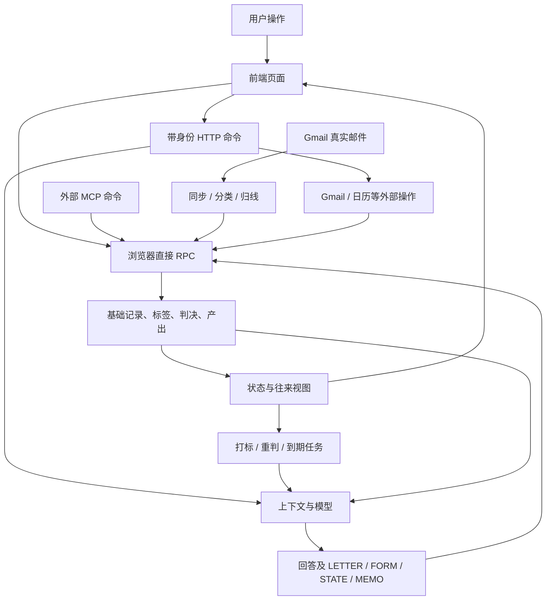
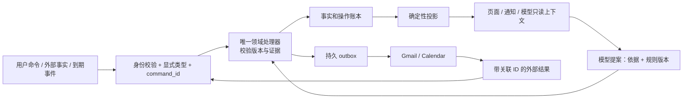

# Fairwind 全系统规则、决策与数据流审计

审计日期：2026-10-23（洛杉矶）。正式站 https://fairwind.hudiworks.com/。

## 结论

**当前系统不能被认定为具有全局统一、单向、可追溯的决策数据流。**
有清楚的局部边界（租户、真实邮件证据、日历同步、部分后台队列），但跨边界的命令类型、事实来源、提醒推导和外部操作完成状态没有统一契约。问题不只是几张卡的样式，也不是单一模型提示词能修好。

本报告完成一次横向架构审计，并附带小范围、可独立回滚的修复。它不是“全系统重构已完成”的证明，也不是安全渗透测试。数据库状态投影、邮件操作账本、统一命令层仍需迁移和验收。

## 基线、方法与边界

- 生产基线：Render `dep-dbe2cl7avr4c739rnc80`，源码 `2b27093e78dc97ffe6893d4f35383117de88ab7b`。本次在它的隔离 checkout 上工作；原目录和旧工作树未覆盖。
- 读取生产 PostgreSQL 函数、视图和非内部触发器定义；当前 producer 33 张表，public 34 个视图。对用户指出的两段记录做只读追溯，没有修改历史用户记录。
- 从 UI 命令、HTTP/MCP、模型工具、后台轮询，追踪至 RPC、基础表、投影视图、UI/context。区分仍在使用的逻辑与历史兼容代码。
- 检查聊天、联系人、机会线、书桌/作品资料、产出、邮件、提醒、任务/找机会、日历、附件、账号配置、备份、MCP、部署与可观测性。
- 不执行真实发信、付费模型探针、全邮箱扫描或生产恢复演练。全量自动测试通过不等于这些外部路径已经端到端验收。
- 生产数据和完整 SQL 取证保留在本地 `fixes/2026-10-23-flow-audit/`，不随本报告提交用户内容或凭据。

## 实际数据流

图里的回路不全是错误：新来信触发判断、判断触发到期任务是合理的。真正的问题是，派生内容重新进入系统时没有始终保留“它是谁产生、依据哪次事实、能不能成为下一次决策依据”的边界。

## 检查范围与权威来源

| 子系统 | 当前入口与主要权威数据 | 审计结果 |
|---|---|---|
| 聊天、机会线、联系人、书桌 | `useChat`、`PersonFocus.say` → `/chat` → messages | 聊天存在两套编排；健康失败曾改写操作类型，已修代码；重试还缺持久命令 ID |
| 邮件收取、分类、认领 | `mailRound`、mail/sync/adopt/evidence → Gmail ID、mail_headers、真实 email 行 | SENT/DRAFT 证据边界已有保护；归线与派生通知仍须保持明确类型 |
| 草稿、定稿、发出 | artifact、gmail/draft、mail/send → deliverables + Gmail | 没有完整持久操作状态机；定稿与发送语义未充分分离 |
| 提醒与下一步 | message_tags、letter_verdicts、next_touch → `v_pa_state` / cue views | 面板统一读状态视图，但决策来源和消除规则不统一 |
| 自动任务/找机会 | scout queue、task start/finish、机会池 → pursuits | scout 有持久领取和检查点；timer 主要靠进程锁及消息键，保证不同 |
| 日历 | `v_pa_state` → calendar service → Google | 用户显式启用；确定性事件 ID、条件更新、冲突保护较完整 |
| 卡片/人/资料 CRUD | UI 与 MCP → invoker RPC → 基础表 | 归属通过身份/RLS；业务规则分布在客户端、模型、RPC，缺统一命令清单 |
| 附件 | Storage 字节 + attachment RPC | 上传登记失败有补偿清理；跨存储操作不是事务，需持久清理重试 |
| 配置/判据/模型 | tenant settings、judgment docs、provider adapter | 凭据按租户隔离；静态提示、用户判据、业务 SQL 的优先级缺显式版本契约 |
| 备份恢复 | authenticated routes → diskImport/roundtrip | 限额/校验/租户测试已有；导入锁是进程内，未做生产恢复演练 |
| MCP | token → tenant → schema-validated tools/RPC | 明确命令和参数校验；应与 UI/worker 复用同一领域命令服务 |
| UI 刷新/缓存 | pulse、query loaders、local navigation | pulse 是失效通知，不是事实来源；查询失败与空结果须持续分开。hosted demo alias 是空数据，不能误报线上会显示示例人名 |
| 部署/追溯 | Render 指定提交、GitHub、持久盘 | 当前部署可核对；health 的固定 build 文案不足以独立标识当前源码 |

## 已证实的问题与风险

### F01 — 聊天被静默变成笔记（高，已修代码）

`src/lib/useChat.js` 和 `src/components/PersonFocus.jsx` 的 health-down 分支直接调用记笔 RPC，不调用聊天服务。健康检查的任何网络/鉴权/重启失败都可能走这里。用户指出的回答确实是 note/note，而不是 artist/message；没有相应聊天调用记录可恢复。

修复：移除两处转换；连接状态只影响提示，发送仍然请求聊天。失败保留输入；服务已确认保存的消息不重复还回输入。历史有相同文本不再被直接视为本次已保存。

限制：尚无持久 command_id，断连后“恰好有另一端发了同样文本”的极端情况仍需命令账本解决。历史误记记录没有自动重放或重新调用模型。

### F02 — 笔记可以无条件消掉提醒（高，待数据库迁移）

生产 `v_pa_state.current_open` 对 NEEDS_REPLY 的消除条件包含“之后存在任意 note/meet/decision”；`owe_meet` 也用后来的任意 note/decision 消除会后提醒。它们不要求该笔记明确表示已回复，也不要求 `resolves=true`。

因此 F01 不仅造成缺少回答，还可能让待办消失。这里不是推测模型意图，而是生产 SQL 的明确行为。

目标：只有真实发送证据或显式完成命令/已校验解析可以关闭对应提醒；普通补充资料不能关闭提醒。迁移前必须做全账号影子投影差异报告。直接去掉条件可能令大量历史提醒重新出现并触发 timer，不应无预演切换。

### F03 — 多套判断仍然同时工作（高，待收敛）

`mailRound` 仍顺序执行 tagPass、judgePass、timerPass。tagPass 写 message_tags；judgePass 的 rejudge/triage 写 next_touch、letter_verdicts 和判断水位；聊天 STATE 通过 pa_apply_state_move 再写派生 decision 与 tag。它们职责有重叠，但不是完全读同一组字段。旧链路不能因为注释说“退役”就当成没运行。

目标：一个带版本的领域状态投影；每个输入事件只产生一次可追溯决策。保留模型提案与依据，不能把模型输出本身当事实。先影子比较新旧结果，再停用重复写入者。

### F04 — 派生记录被当成对话或往来事实（高，部分已修代码）

- 到达通知 arrival 的 producer role 被旧联系人界面当作 Fairwind 发言：之前的发布已改成有方向/日期/原文的邮件通知。
- `historyBlock` 原先把 arrival 放进助手聊天，把系统 STATE/MEMO 生成的记录与来源不明笔记混放。本次单独标注系统派生内容与 source_message_id；多封 letters 均作为草稿进入上下文。
- 更深处：生产 `pa_subjects_for_rejudge` 把 email/note/meet/decision 混成 `mails`，方向用 `role='org' ? in : out`，因而 note 也会被表述成 out。这个旧重判上下文仍需 SQL 契约迁移；本次 historyBlock 修复不覆盖它。
- STATE 的应用记录既作为父回复上的卡片，又作为独立 decision 显示。保存审计记录是合理的，界面不应把同一动作展示成另一条用户决定。

没有证据证明存在无限递归：pa_apply_state_move 已为派生 decision 打标，pa_facts_to_judge 会排除已有标签记录。不能把重复展示误说成后台无限执行。

### F05 — 已发送后的草稿缺少持久闭环（高，待操作账本）

`recordSent` 依次记邮件、信头、归线，然后硬删除 deliverable；原助手回复的 LETTER 仍在。`handleArtifact` 找不到产出时会从 LETTER 再生成，因此存在发送后重新出现可操作草稿的路径。它不等于已证实发生了重复发信。

存 Gmail 草稿只保存 gmail_draft_id，外部发送没有完整的 draft → SENT 对账。界面“在草稿箱”不能代替真实状态。

目标：保留 artifact 身份；编辑状态与发送状态分离。记录 draft / saved_in_gmail / sending / sent / outcome_unknown / failed / discarded，并保留邮件证据关联。外部发送必须按账户和 Gmail 身份核对，不按正文相似度猜。

### F06 — 外部发送与内部记账可能分叉（高，待操作账本）

Gmail 发送成功之后，任何记账步骤失败都会抛异常；草稿可能仍可发送。后端没有可跨进程重启的 send claim/result ledger。两标签页并发也不能靠单个 UI busy 保证只发一次。

现有 Gmail transport 不自动重试不确定发送，这是正确保护；但整体流程仍不够。

目标：先持久领取 command_id 和产出版本，再调用外部服务；成功结果先持久保存，记账可重复补偿；结果未知时禁止自动重发，要求证据核对。用故障注入测试每个断点，不拿真实联系人试发。

### F07 — 写失败却推进判断水位（高，已修代码，事务仍待完善）

rejudgeThese 原先忽略 next_touch、letter_verdict、recompute 的部分错误，仍调用 pa_mark_judged。失败的决定会被误当完成，下轮不再重试。

本次提取 persistRejudgment：任何依赖写失败都停止，只有全部成功才推进输入快照水位；缺少快照拒绝写入，不以模型结束时间代替。加入各断点失败测试。

限制：这是失败时停止推进，不是数据库事务，也没有 compare-and-swap；并发判断的最后写入竞争仍需统一领域命令解决。

### F08 — “已处理”按钮不是原子操作（中高，待迁移）

`src/lib/notifications.js markHandled` 先写笔记，再打 resolves tag，再可能写感谢完成；后两步错误没有检查，最终仍返回 true。应合并成一个受 RLS 限制的事务 RPC，携带 anchor/version；失败不呈现“已处理”。只加错误提示不能撤销已经发生的第一步。

### F09 — 定时任务身份与并发保证不足（中高，待迁移）

timerKey 用 state + subject_id + since_at 的日期，丢失当天多次锚点和 subject_kind。timer 的去重/锁与 scout 的持久 claim 不一致。聊天与 timer 解析的信封集合也不同（timer 没有同一套 MEMO/FORM 管道）。

目标：任务键包含 owner、subject_kind、subject_id、anchor_id、规则版本；数据库唯一领取、lease、完成结果；重启和双 worker 下仍只产生一次产出。旧 timer key 必须迁移，不能直接换格式导致全部重跑。

### F10 — 规则优先级与注释漂移（中，部分已修代码）

MEMO_RULE 既说商量默认不记，又说“拿不准要不要记，记”。本次改为仅保存明确事实/明确保存要求，且记录不能代替回答、查资料、起草。它是提示词约束，不能代替结构校验。

useChat 注释曾声称“现在只有一份”，但 PersonFocus 仍另有编排。多个旧注释描述的旧产品/部署不是当前运行事实。应建立规则注册表：ID、版本、输入证据、唯一写入者、优先级、回归用例。用户自定义判据可以调整建议，不能越过发送、身份、事实类型等硬边界。

### F11 — 观测与恢复没有统一标准（中，待治理）

不同模块分别使用 RPC errors、日志、usage、消息 meta、文件状态；没有贯穿 UI → 模型 → DB → 外部服务的持久 operation_id。固定 health build 文案不能准确解释线上运行哪个版本。附件补偿、导入锁和浏览器后台批量任务也没有统一可恢复队列。

目标：每个命令记录 actor、intent、source、evidence IDs、expected version、operation ID、结果和规则版本；不记录密钥。失败、未知、已确认完成是不同状态，监控必须区分。

## 目标架构与不可破坏的规则

“单向”指每一次处理都按明确顺序流动，不意味着禁止新事件反馈。模型不能自行把自己的旧回答升级为外部事实；UI 不能凭显示状态宣布发送完成。

1. 聊天、记笔、起草、存草稿、发送、完成提醒是不同命令；健康检查没有改命令的权限。
2. 事实、用户陈述、模型判断、系统通知分别有类型与来源；role 不是类型。
3. 每种业务状态只有一个定义、一个投影入口；多个界面可以发同一命令，不能各自实现规则。
4. 模型只给带证据的提案；写入由确定性校验器决定，过期提案不能覆盖新事实。
5. 每个外部动作必须有持久 ID、明确结果与恢复方式；结果未知不等于失败可重发。
6. 派生消息不会成为新的独立事实；通知可以重新生成，不能改变事实。
7. 一条事件重复到达不产生重复状态、产出或发送；并发与重启都必须满足。
8. 普通补充资料不自动完成待办；完成必须指向明确锚点。
9. 查询失败不能解释为“没有数据”，写入部分成功不能解释为全部完成。
10. 每个生产发布都可对应 Git 提交、规则版本、数据库迁移和回滚方案。

## 迁移顺序与验收门槛

| 顺序 | 工作 | 完成门槛 |
|---|---|---|
| A，本次 | 保留聊天意图、上下文来源分离、MEMO 规则、水位失败保护 | 新回归 + 全套测试 + hosted 构建；上线后核对发布来源；不重写历史记录 |
| B | 领域命令与状态投影：F02/F03/F04/F08 | 用生产只读快照影子计算；逐项解释提醒增减；普通 note 不清 NEEDS_REPLY；显式 done 只关对应 anchor；双写不对外触发 timer |
| C | 邮件产出及外部操作账本：F05/F06 | Gmail 成功/DB失败、超时未知、重复点击、两标签页、重启、外部发出均不重发且可对账；已发产出不能再生成未发卡 |
| D | 定时器统一持久任务：F09 | 双 worker、租约过期、同日新锚点、旧键迁移、失效提案均通过；不全量重复起草 |
| E | 规则注册、观测、补偿队列：F10/F11 | 所有写入口列入命令表；能够追溯一次用户操作及失败恢复；规则与部署版本可见 |

B–E 尚未完成，不能以 A 的发布宣布系统已整体理顺。下一轮应从 B 的影子投影和 C 的发送操作账本着手，不能继续只调提示词。

## 本次验证与发布

原有自动测试在补齐环境后：846/846 通过，说明原覆盖不足以发现上述架构问题。第一次运行因隔离目录缺后端依赖及 loopback sandbox 失败，补齐已有依赖路径并允许测试本地监听后全部通过；不把环境错误算产品回归。

本次增加聊天意图/失败恢复、上下文派生来源/多草稿、水位写入失败断点测试。最终全量测试、构建与实际部署结果记录在后续发布小节。

最终回归：857/857 通过（新增 11 项）；hosted Vite 构建、server.js 语法及 diff 检查通过。最后的来源关联字段修正另跑 6 项 context 测试通过。没有调用真实模型或发送邮件。

### 提醒规则的只读影子验证

对当前请求账号，以同一次只读事务比较现有 v_pa_state 与“普通笔记只有带 resolves 标签才消除提醒”的候选投影。没有创建/替换视图、修改记录或触发 worker。

该候选在当前快照改变 1 个对象的最终状态：MEETING_SET → NEEDS_REPLY。其余对象最终状态/锚点/到期时间一致。这说明变化不只是文案；也说明不能把“可能唤起大量历史提醒”当成这次账号快照已发生的事实。仍需针对发生变化的证据链、其他账号和历史边界分别验收，且这个候选不是完整的新领域状态机。

### 已发布的基础修复

2026-10-23 20:46 PDT 发起，Render 在 1m31s 后报告 Deploy succeeded / Live。实际发布提交 `e79a51cb8bf569687340d50eb86056919ed86160`，部署 `dep-dbe2k8hsrm7s73degoj0`，GitHub `codex/quiet-drafts-20261023` 已推送。

正式 health 与首页均 HTTP 200；首页引用 `index-D0cCchr5.js`，新的 `App-DOtj1QRf.js` 包含连接失败保留聊天语义的提示，已无旧“直接记成一笔”提示。已登录页面刷新正常。没有向真实对话发送测试消息，没有发送邮件或修改历史用户数据。后端失败场景通过本地故障注入回归验证，未在生产强造数据库故障。

代码回滚：在当前 Render 服务手动部署前一提交 `2b27093e78dc97ffe6893d4f35383117de88ab7b`。本次没有数据库迁移，无数据回滚；回滚代码会恢复旧聊天降级缺陷。影子验证不改变生产状态。
